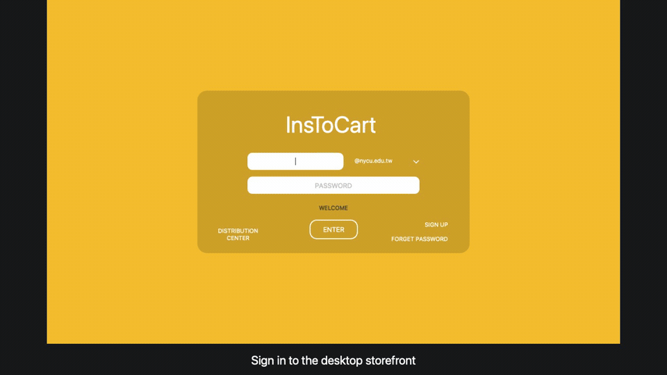

# InsToCart

InsToCart is a Qt desktop storefront prototype. It preserves the project's original login and product catalog forms while organizing the application around screens, domain models, and interchangeable SQL storage. Visitors can run it with SQLite; contributors can connect the same UI to a local MySQL database.



[Download the full-resolution MP4](docs/media/instocart-demo.mp4?raw=true)

## Quick start on macOS

Requires Qt 5 (`qmake`), Xcode command line tools, and the Qt SQLite driver.

```sh
./scripts/build-macos.sh
./build/InsToCart.app/Contents/MacOS/InsToCart
```

SQLite is the default. It stores data under the macOS application data directory. To use a custom location, set `INSTOCART_DATA_DIR` before launching. For MySQL setup and its Qt driver, read [docs/mysql-setup.md](docs/mysql-setup.md).

## Implementation highlights

- A `QAbstractListModel` exposes product IDs, names, prices, stock, categories, and images. Two proxy models handle search and sort, then select eight products for the current page.
- A `QStyledItemDelegate` creates a card with native Qt controls for quantity, details, and add to cart. The click handler receives the bound product ID, so changing the sort order or page still updates the intended product.
- Qt Test covers model and proxy contracts, card actions, checkout rollback, and SQLite persistence. GitHub Actions runs the suite on Ubuntu with Qt 5.

Run the tests with `./scripts/test-qt.sh`. On macOS, run the UI tests with `QT_QPA_PLATFORM=cocoa ./scripts/test-qt.sh`. To edit or run the app in Qt Creator, open `app/InsToCart.pro` and select your Qt 5 desktop kit.

## Demo scope

Create an account, browse the catalog, add products to the cart, and place a local order. The optional MySQL backend and setup instructions are included. The `QMYSQL` connection has yet to be verified on the development Mac. Additional original Designer forms in `app/forms/reference/` document the earlier design.

## Structure

```text
InsToCart/
├── app/
│   ├── assets/              # images and icons
│   ├── forms/               # original Qt Designer forms
│   │   └── reference/       # preserved forms outside the current flow
│   ├── src/
│   │   ├── screens/         # login, catalog, cart
│   │   ├── catalog/         # model, proxies, and card delegate
│   │   ├── domain/          # product and cart data types
│   │   └── storage/
│   │       ├── sqlite/      # SQLite connection
│   │       └── mysql/       # MySQL connection
│   ├── InsToCart.pro
│   └── resources.qrc
├── database/
│   ├── sqlite/              # schema and sample data
│   └── mysql/               # schema and sample data
├── docs/
├── scripts/
├── tests/
└── README.md
```

See [docs/architecture.md](docs/architecture.md) for the data flow and current scope. No database credentials or generated database files belong in this repository.
